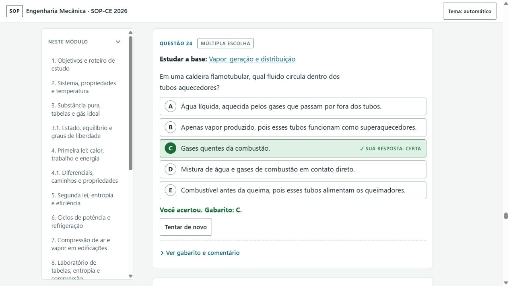

# BAN-07 r1 — verificação de navegador do coordenador

Data: 28/10/2026. Responsável: agente automatizado /root, coordenador. Não é parecer do Auditor.

A verificação antes/depois usou uma origem local temporária. Q24 A e AV08 D foram respondidas na base anterior; Q23 C foi respondida como controle de conteúdo preservado. Na versão corrigida, Q24 e AV08 exigiram nova tentativa e exibiram aviso de histórico. Q23 C continuou marcada. Novas respostas C em Q24 e AV08 persistiram após recarga. O console observado não registrou erros ou avisos.

Os resultados, hashes e limites estão em [navegador-coordenador-r1.json](navegador-coordenador-r1.json). A preservação interna dos mapas é verificada separadamente nas suítes VM; esta inspeção lê somente a interface. A captura de Q24 mostra as cinco alternativas corrigidas e o feedback legíveis.

